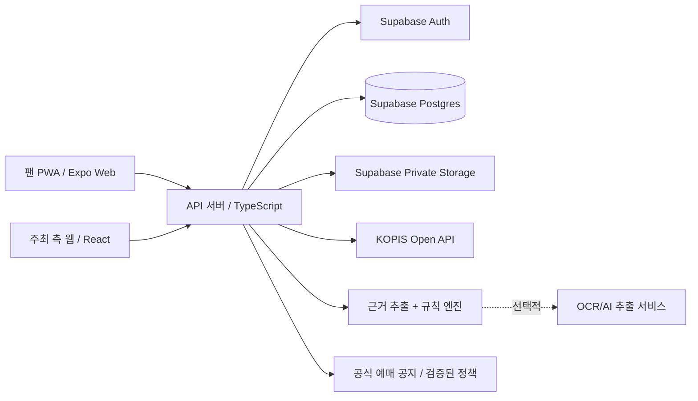

# 티켓레이더 | AID 해커톤 팀 공유 기획·기술 명세

> 작성 기준: 2026-10-16 · 상태: **제안/설계 단계**  
> 원안: 팀에서 공유한 `해커톤 기획서.zip`의 기획서·목업·Expo PWA 가이드  
> 이 문서는 원안에 **구매 전 입장 규정 충돌 점검**을 핵심 차별점으로 제안한 공유용 정리본이다. 실제 앱·데이터 수집·AI 판정 성능·운영기관 연동은 아직 검증되지 않았다.

## 1. 한눈에 보는 아이디어

**티켓레이더는 팬이 중고 티켓 판매글을 보고 결제하기 전에 공식 가격과 공연별 입장·양도 규정을 대조하고, 확인이 필요한 근거를 설명하며, 제보 자료를 정리하도록 돕는 서비스다.**

```
판매글 입력 → 공연·좌석·가격·전달 방식 추출 → 공식 자료 대조
            → 근거가 보이는 주의 신호 → 팬 확인·수정 → 증거 정리·공식 신고 안내
                                                    ↘ 주최 측 검토 화면(시연)
```

팬의 구매 판단을 돕는 것이 첫 번째 가치다. 주최 측 화면은 허가된 담당자가 제보를 검토하고 필요한 근거를 찾는 도구로 제안한다. 앱이 티켓 진위를 인증하거나, 입장을 보증하거나, 판매자의 위법 행위를 확정하지는 않는다.

### 원안과 이번 제안의 관계

| 원안의 강점 | 이번 공유본에서 강조할 핵심 | 후속 검토 |
| --- | --- | --- |
| 공식 정가와 재판매가 비교 | 공연별 본인 확인·양도·현장 수령 조건까지 함께 비교 | 여러 플랫폼 자동 수집 |
| 팬 제보 → 주최 측 대시보드 | 판매글에서 확인된 문구와 공식 출처를 묶은 검토 자료 | 대규모 판매자 패턴 분석 |
| 모바일 PWA와 운영 웹 목업 | 텍스트 한 건으로 끝까지 작동하는 모바일·웹 시연 | 가격 알림·시장 추이 |

## 2. 문제와 차별점

팬은 판매 가격뿐 아니라 **해당 티켓을 어떤 방식으로 전달받아 입장할 수 있는지** 확인해야 한다. 일부 공연은 예매자 본인 확인이나 현장 수령을 요구하고, 제3자 양도를 제한한다. 판매글의 “캡처로 입장 가능” 같은 설명이 공식 안내와 충돌할 수 있다. 공연마다 조건이 다르므로 한 공연의 규칙을 다른 공연에 적용해서는 안 된다.

이미 공연·스포츠 온라인 암표신고센터가 신고를 접수하고 후속 조치를 안내한다. 티켓레이더의 제안 가치는 신고 창구를 새로 만드는 데 있지 않고, **결제 전 확인·근거 설명·신고 자료 정리**의 연결에 있다.

### 권장 차별화 문구

> “판매글을 붙여넣으면, 해당 공연의 공식 가격과 입장 규정을 대조해 확인할 점을 출처와 함께 보여줍니다.”

### 화면에서 피할 표현

| 피할 표현 | 권장 표현 | 이유 |
| --- | --- | --- |
| “사기·암표 확정”, “위험도 92/100” | “공식 안내와 충돌하는 문구 2건”, “추가 확인 필요” | 위법성·사기 여부와 수치 성능은 별도 검증 대상 |
| “매크로 판매자 탐지” | “대량 판매를 언급한 문구” 또는 “확인된 다수 게시 패턴” | 판매글만으로 매크로 사용을 알 수 없음 |
| “입장 가능”, “안전한 티켓” | “입장 조건을 확인하세요”, “공식 예매처에서 재확인” | 티켓 자체의 진위와 현장 입장은 인증하지 못함 |
| “실시간 전체 시장 감시” | 실제 범위와 마지막 수집 시각 표시 | 플랫폼별 데이터 권한·수집 범위가 미확정 |

## 3. 대상 사용자와 사용자 흐름

| 사용자 | 해야 할 일 | 서비스가 주는 결과 |
| --- | --- | --- |
| 팬 | 판매글의 가격·전달 방식 확인 후 결제 여부 판단 | 정가·공식 규정·주의 문구·공식 경로 링크 |
| 제보자 | URL·캡처·가격을 정리하고 필요 시 신고 | 개인정보를 가린 증거 요약과 제출 전 확인 화면 |
| 주최 측 담당자 | 자신이 담당하는 공연의 제보만 검토 | 원문·출처·수집 시각·처리 상태를 보는 제한된 화면 |

### 정보 구조(IA)

- **팬 PWA:** 공연 검색/선택 → 판매글 입력 → 추출 결과 확인·수정 → 공식 자료 대조 결과 → 제보 자료 확인 → 공식 신고 안내.
- **주최 측 웹:** 로그인 → 담당 공연 목록 → 제보함 → 개별 제보·근거 열람 → 처리 메모/상태 → 내보내기(후속).
- **공통:** 데이터 출처·업데이트 시각, 데모 데이터 표시, 개인정보 안내, 오류·빈 상태·재시도.

### 3분 시연 시나리오

1. 팬이 **사전 선정한 공연 1건**을 선택한다. 공식 안내의 가격·본인 확인·양도 조건과 출처 시각을 보여준다.
2. 판매글 예시를 붙여넣는다. 시스템이 공연명·좌석·판매가·전달 방식·입금 요구 문구를 추출하고 팬이 잘못 읽힌 값을 고친다.
3. “정가 대비 +○%”, “선입금 요구 문구”, “공식 본인 확인 안내와 충돌”을 **원문과 공식 출처 링크**와 함께 보여준다. 수치는 실제 선택한 데이터로 계산한다.
4. 팬이 제보를 선택해 링크·캡처를 검토하고 개인정보를 가린다. 주최 측 시연 계정의 제보함에 같은 건이 나타난다.
5. 담당자는 제보 근거를 확인한다. 실제 정부 신고센터로의 자동 제출이나 플랫폼 삭제는 시연하지 않는다.

## 4. 범위와 완료 조건

### P0 — 대회에서 작동시킬 최소 범위

| 기능 | 완료 조건 |
| --- | --- |
| 공연 1건의 공식 정보 | KOPIS 공연 ID·공식 예매 안내 URL·확인 시각을 저장하고 화면에서 출처를 연다. 가격은 좌석 등급별 실제 값으로 수동 검증한다. |
| 판매글 텍스트 입력 | 붙여넣은 텍스트에서 가격·좌석·선입금/전달 문구를 추출한다. 불명확하면 “확인 불가”로 표시하고 사용자가 수정한다. |
| 규정 충돌 점검 | 선택한 공연에 등록·검증한 공식 규정과 판매글의 문구를 비교한다. 각 결과에 원문/공식 근거/확인 시각을 붙인다. |
| 가격 비교 | 같은 공연·좌석·회차로 일치가 확인된 경우에만 `(판매가 ÷ 기준가격 − 1) × 100`을 계산한다. 다른 좌석·할인 가격이면 비교 보류한다. |
| 제보 | 사용자가 확인한 URL·가격·설명만 제출한다. 캡처 업로드는 개인정보 가림·파일 제한·비공개 저장이 준비된 경우에 연다. |
| 주최 측 제보함 | 검증된 시연용 담당 계정이 배정된 공연의 제보만 조회한다. 다른 계정·공연은 차단한다. |
| 데모 표시 | 시드 데이터와 예시 공연은 모든 관련 화면에서 “시뮬레이션/예시”라고 표시한다. |

### P1 — P0가 작동한 뒤 확장

- 캡처 OCR·AI 구조화 추출과 근거 위치 표시. 개인정보가 외부 AI 제공자에게 전송되는 경우 별도 동의·고지가 필요하다.
- 증거 PDF 내보내기, 공식 신고용 요약 복사, 공식 취소·양도 경로 안내.
- 허용된 한 플랫폼의 공개 매물 수집과 출처·수집시각 표시. 이용약관·robots.txt·호출 한도를 먼저 확인한다.
- 공연별 가격 추이, 알림, 중복 게시 패턴. 판매자 동일성은 확인 가능한 식별 기준이 있을 때만 다룬다.

### 이번 데모의 범위 밖

티켓 거래·결제·양도 중개, 티켓 진위 인증, 자동 법적 판정, 매크로 사용 확정, 플랫폼 게시글 자동 삭제, 정부 신고센터 자동 제출, 검증되지 않은 다중 플랫폼 전수 수집.

## 5. 데이터와 판단 규칙

| 자료 | 우선 출처 | 저장·표시 원칙 |
| --- | --- | --- |
| 공연 기본 정보·티켓가격 | KOPIS Open API, 해당 공연의 공식 예매처·주최 측 공지 | KOPIS 출처 표시. API의 가격은 문자열일 수 있어 등급·회차·할인 조건을 검증하고 원문을 보존한다. |
| 입장·양도·본인 확인 규정 | 해당 공연의 공식 예매 안내/주최 공지 | URL, 짧은 근거 문구, 확인 시각, 검토자를 기록. 규정 변경 시 재검토한다. |
| 판매글 | 팬이 직접 입력한 텍스트·URL·선택적 캡처 | 입력만으로 판매자 동일인·티켓 진위·매크로 사용을 단정하지 않는다. |
| 데모 매물 | 명확히 표시한 합성 시드 데이터 | 실제 시세·성과 측정으로 발표하지 않는다. |
| 제보 증거 | 팬이 확인해 제출한 자료 | 캡처의 전화번호·계좌·얼굴 등 필요 없는 개인정보를 가리고 비공개 저장한다. |

**판단 엔진은 “근거 추출”과 “규칙 적용”을 분리한다.** AI/OCR이 판매글에서 구조화 값을 제안하더라도, 공식 규정 충돌·가격 계산은 결정 가능한 규칙으로 처리하고 사람이 확인한다. 출력은 발견된 조건과 원문 인용을 보여주며, 단일 `risk_score`를 MVP의 사실 판정처럼 쓰지 않는다.

예시 규칙:

```text
IF 공식 안내가 “예매자 본인 현장 수령”이고 판매글이 “QR 캡처만 전달”이라면
  → “공식 수령 조건과 판매글 설명이 충돌합니다. 구매 전 예매처에 확인하세요.”
IF 공식 가격·좌석 등급이 일치하고 판매가가 더 높다면
  → 차액과 비율을 계산해 표시한다. 이것만으로 불법 여부는 판단하지 않는다.
IF “입금 먼저” 문구가 있다면
  → 원문 문구를 보여주고 전달·환불 조건을 확인하도록 안내한다.
```

## 6. 권장 기술 스택과 선택 이유

| 계층 | 권장 도구 | 쓰는 이유 / 확인할 점 |
| --- | --- | --- |
| 팬 화면 | Expo + React Native Web + TypeScript, PWA | 팀 원안의 모바일·웹 공유 코드. 웹 내보내기·설치·카메라/업로드 동작은 실제 iPhone Safari와 Android Chrome에서 따로 검사한다. |
| 주최 측 화면 | React + Vite + TypeScript | 제보 목록/상세·필터·검토 화면. 좁은 화면과 큰 글자도 확인한다. |
| 공유 형식 | TypeScript 공유 패키지 + Zod 등의 스키마 검증 | 앱·웹·API가 같은 요청/응답 필드와 오류 코드를 사용한다. 의존성은 버전을 고정하고 lockfile을 보관한다. |
| API/동기화 | Node.js + TypeScript + Express, 예약 작업 | 원안의 서버 구성을 유지. KOPIS 키·선택적 AI 키를 서버에만 보관하고 공연 동기화·텍스트 검사 API를 제공한다. |
| 허용된 매물 감시(후속) | 서버 `fetch` + Cheerio; 필요한 경우 Playwright | 이용조건이 허용된 한 출처부터 수집. 정적 HTML은 Cheerio로 파싱하고 브라우저 실행이 꼭 필요한 경우에만 Playwright 사용. 로그인·차단·캡차 우회는 하지 않는다. |
| 후보 분류 | TypeScript 규칙 엔진 + Zod 검증; AI 추출은 선택 | 공연·회차·좌석 일치 확인 후 가격·선입금·공식 규정 충돌 신호를 설명한다. 법적 위반 점수로 표현하지 않는다. |
| 데이터/인증/파일 | Supabase Postgres + Auth + 비공개 Storage; 필요 시 Realtime | 공개 공연 정보와 제보·담당자 권한을 분리. 노출 스키마 RLS와 API 권한을 모두 설정한다. |
| 공식 데이터 | KOPIS Open API + 공연별 공식 예매 공지 | 공연 가격·규정 출처를 연결. 스포츠는 KOPIS 범위 밖이므로 첫 데모에서는 공연에 집중한다. |
| AI(선택) | 서버의 구조화 추출 API 또는 로컬/서버 OCR | 자유 형식 판매글에서 후보값 추출. 제3자 전송·비용·오인식·프롬프트 주입 방어를 검토한다. |
| 배포(안) | Netlify 2개 사이트 + Render API/작업 서버 | 원안의 분리 구조. 무료 플랜 지연·스케줄 한도·환경변수·HTTPS를 실제 배포에서 확인한다. |
| 검증 | Vitest, React Testing Library, Playwright, SQL/RLS 검사 | 추출 규칙, 가격 계산, 계정 격리, 팬→담당자 왕복을 각각 검증한다. |

**PWA는 웹 배포안이다.** 홈 화면 추가가 가능하더라도 네이티브 앱 설치·푸시·카메라·오프라인 동작을 같은 수준으로 주장하지 않는다. 공식 Expo PWA 가이드를 기준으로 빌드 설정을 검증한다.

### 매물 감시 기술의 실제 범위

```text
허용된 API/공개 출처 또는 팬 제출 → 원본 출처·시각 기록 → 필드 정규화·중복 제거
→ 공연/회차/좌석 대조 → 근거 있는 주의 신호 → 사람 검토 대기열 → 담당 화면 알림
```

- **대회 시연:** 팬이 넣은 판매글과 이용이 허용된 출처 1곳을 대상으로 시작한다. 허용된 자동 수집 출처가 없다면 “팬 제보 분석”이라고 부르며 “전 플랫폼 자동 감시”로 표시하지 않는다.
- **데이터 정규화:** `source`, `source_url`, `collected_at`, `event_id`, `showtime`, `seat_grade`, `price`, `quantity`, `seller_id_on_source`를 구조화한다. 같은 플랫폼에서 확인된 ID나 URL만 중복 판단에 사용한다. 비슷한 닉네임만으로 다른 플랫폼의 동일 판매자라고 단정하지 않는다.
- **판단:** 동일한 공연·회차·좌석 가격만 비교하고, 원문에 있는 선입금/전달 문구와 검증된 공식 규정의 충돌을 별도로 표시한다. AI가 필드를 제안해도 사용자가 수정할 수 있어야 한다.
- **알림:** DB에 새 후보가 들어오면 승인된 담당자의 비공개 Realtime 채널로 알릴 수 있다. Realtime은 **우리 DB 변경을 전달**할 뿐 외부 사이트를 감시하지 않는다.
- **검증:** 수집 성공·누락·중복 건수와 추출 정확도를 표본별로 기록한다. 실제 값이 나오기 전에는 탐지율이나 “실시간” 지연 시간을 발표 수치로 제시하지 않는다.

## 7. 시스템 아키텍처



1. 서버가 KOPIS에서 공연 메타데이터를 동기화한다. 공연별 입장 규정은 공식 URL과 함께 사람이 확인해 저장한다.
2. 팬 입력은 API에서 크기·형식을 검사하고, 임의 URL을 서버가 무조건 가져오지 않는다. 텍스트는 외부의 신뢰할 수 없는 입력으로 취급한다.
3. 추출 후보와 규정 대조 결과를 팬에게 보여준다. 팬이 수정·확인한 뒤에만 제보를 만든다.
4. 로그인한 주최 측 담당자는 배정된 공연의 제보만 읽는다. 실제 주최 측 자격 확인 전에는 합성 시연 계정이라고 표시한다.
5. 프런트에는 Supabase publishable 키만 사용한다. 새 프로젝트의 서버 비밀은 secret 키를 사용하고, 레거시 `service_role` 키가 남아 있더라도 공개 코드에 넣지 않는다. 비밀 키는 권한을 우회할 수 있으므로 사용자 요청의 권한을 별도로 검증한다.

### 최소 데이터 모델(제안)

| 테이블/저장소 | 주요 필드 | 접근 원칙 |
| --- | --- | --- |
| `events` | `id`, `kopis_id`, `title`, `starts_at`, `official_url`, `source_checked_at` | 확인된 공개 정보만 읽기 |
| `price_tiers` | `event_id`, `seat_grade`, `face_price`, `source_text`, `verified_at` | 같은 회차·등급 대조에 사용 |
| `ticket_policies` | `event_id`, `policy_type`, `excerpt`, `source_url`, `verified_at` | 공식 출처 연결, 수정 이력 보존 |
| `checks` | `id`, `user_id`(선택), `event_id`, `extracted_fields`, `findings`, `created_at` | 원문 기본 비보관, 사용자별 접근 |
| `reports` | `id`, `event_id`, `reporter_id`, `listing_url`, `verified_fields`, `status`, `created_at` | 제보자와 배정 담당자만 접근 |
| `org_memberships` / `org_events` | `user_id`, `org_id`, `event_id`, `role` | 서버에서 검증한 소속만 권한 부여 |
| `report-assets` 비공개 버킷 | 제보 캡처 경로·형식·크기·가림 상태 | 보고 대상별 제한된 읽기, 만료·삭제 정책 |
| `audit_events` | 행위자, 대상 제보, 작업, 시각 | 담당자 열람·내보내기 이력, 일반 사용자 비노출 |

노출 스키마의 테이블은 RLS를 켜고 별도 `GRANT`와 각 작업별 정책을 설정한다. `org_memberships`는 사용자 수정 가능한 메타데이터로 대체하지 않는다. 비공개 Storage 버킷에도 접근 정책을 적용한다.

### API 초안

| 메서드 | 경로 | 응답/권한 |
| --- | --- | --- |
| `GET` | `/events?q=` | 공개 공연 검색 결과와 출처 |
| `GET` | `/events/:id/official-context` | 기준 가격·입장 규정·URL·확인 시각 |
| `POST` | `/checks` | 판매글 텍스트/공연 ID → 추출 후보·근거·비교 결과. 입력 제한·호출량 제한 |
| `POST` | `/reports` | 로그인한 사용자가 확인한 제보 저장. 중복 전송 방지 |
| `GET` | `/organizer/reports?event_id=` | 해당 공연 권한을 가진 담당자만 조회 |
| `PATCH` | `/organizer/reports/:id` | 검토 상태·메모. 권한·감사 기록 필수 |
| `GET` | `/organizer/reports/:id/export` | 후속 기능. 지정 담당자만 최소 정보 내보내기 |

## 8. 보안·개인정보·운영 원칙

- **권한:** 팬, 제보자, 주최 측 담당자, 운영자를 분리한다. 시연용 담당자 계정은 실제 주최 측 인증으로 표현하지 않는다.
- **증거 파일:** 비공개 버킷, 파일 형식·용량 제한, 화면 가림, 악성 파일 검사 가능성, 보관·삭제 기간을 결정한다. 제보자의 연락처나 판매자 계좌를 공개 대시보드에 노출하지 않는다.
- **외부 AI:** 제보 캡처를 AI API에 보내는 경우 전송 항목·사업자·보관 정책을 확인하고 동의를 받는다. 원문을 AI 지시로 실행하지 않고, 구조화 응답을 스키마로 검증한다.
- **링크:** URL은 텍스트·공식 링크 안내로 먼저 취급한다. 서버가 임의 URL을 가져와야 한다면 내부망 접근·리디렉션·파일 다운로드를 차단한다.
- **표현:** 가격 상승, 다량 판매, 선입금 요청은 검토 신호다. 법적 위반·사기·티켓 진위는 자동 확정하지 않는다.
- **신고 연계:** 현재 공식 신고센터로 자동 전송하는 API 권한은 확인되지 않았다. 공식 신고 링크와 사용자 확인용 요약을 제공하는 수준으로 설명한다.

## 9. 검증 계획과 발표 근거

| 검증 항목 | 실행 증거 | 발표에서 말할 수 있는 범위 |
| --- | --- | --- |
| 가격·규정 출처 | 선택 공연의 공식 URL, 확인 시각, 좌석 등급·회차 대조 | “이 공연에 대해 공식 자료를 확인했다” |
| 추출 정확성 | 실제 사용 가능한 사례와 합성 사례를 구분한 정답표, 오인식·보류 사례 | 측정한 표본과 조건만 설명 |
| 경고 설명 | 각 주의 신호의 판매글 원문과 공식 규정 연결 | “근거를 제시했다”; 사기 판정 성능 아님 |
| 팬→주최 측 왕복 | 서로 다른 계정/브라우저에서 제보 생성·수신·재조회 | 검증한 환경·기기·시각만 설명 |
| 권한 | 다른 주최 측 계정의 제보/파일 접근 차단, 로그아웃 후 비노출 | 시연 계정 간 격리 검증 |
| PWA | 모바일 Safari/Chrome 열기, 홈 화면 추가, 카메라/파일 업로드 | 확인한 OS·브라우저에서만 동작 주장 |
| AI 활용 과정 | 프롬프트·생성 코드·사람의 수정·테스트·오류 수정 기록 | 바이브코딩 제작 과정의 실제 근거 |

테스트 통과, 빌드, 배포, 브라우저 화면, 실기기 조작, 실제 데이터 사용, 주최 측 도입은 각각 별도의 완료 항목으로 기록한다. 시간 절감이나 판정 성능은 시뮬레이션으로 수치를 만들지 않고 실제 검사 후에만 제시한다.

## 10. 실행 순서와 팀 결정 사항

### 바로 결정할 것

1. **데모 공연 1건과 공식 출처:** KOPIS 공연 ID, 가격·좌석·본인 확인·양도 조건이 함께 확인되는 공연을 고른다.
2. **출품 문구:** 판매글 규정 충돌 점검을 핵심으로 할지, 기존의 리셀 시장 모니터링을 핵심으로 할지 확정한다. 이 문서는 전자를 권장한다.
3. **4명 역할과 담당자:** 팬 화면, 주최 측 화면, API·데이터·보안, 출처 검증·QA·발표를 누가 책임질지 이름과 인계물을 채운다. 기존 해커톤 역할을 자동으로 이식하지 않는다.
4. **제보/AI 처리:** 로그인 방식, 캡처 보관 여부, 외부 AI 전송 여부·고지, 공식 신고 링크 범위를 결정한다.
5. **데이터 사용:** 리셀 플랫폼 자동 수집을 하려면 대상 사이트의 이용조건과 허용 범위를 먼저 확인한다. 그 전에는 사용자 입력·명시적 합성 데이터로 시연한다.

### 권장 단계

| 단계 | 산출물 | 종료 조건 |
| --- | --- | --- |
| 0. 출처·규정 확인 | 데모 공연, 공식 가격/규정 URL, 예시 판매글, 경쟁 서비스 표 | 정가·입장 조건·시연 데이터의 출처가 설명됨 |
| 1. 단일 흐름 구현 | 팬 입력·규정 충돌·근거 화면 | 입력 한 건에서 잘못 읽힌 값 수정과 보류 처리 가능 |
| 2. 제보 왕복 | 로그인·비공개 증거·주최 측 제보함 | 두 계정의 실시간/재조회·권한 차단 확인 |
| 3. 발표 검증 | 실제 기기 QR/PWA, 녹화 백업, 테스트·AI 작업 기록 | 3분 시연을 두 번 재현하고 한계를 정확히 말함 |

이번 대회의 **신청 마감은 2026-10-20**로 공지돼 있다. 대회 운영·결과물 제출의 세부 시각, 사전 개발 허용 범위, 중복 출품 규칙은 별도 확인 후 팀 일정표에 입력한다.

## 11. 주요 위험·단점·대응

| 위험/단점 | 왜 중요한가 | 현실적인 대응 |
| --- | --- | --- |
| 기존 신고센터와 기능 중복 | 단순 신고 앱은 새로움이 약함 | 결제 전 공식 규정 충돌 확인과 근거 표시를 중심 데모로 둔다. |
| 리셀 매물 수집 권한 미확정 | 여러 플랫폼의 완전한 실시간 데이터 확보가 어렵다 | P0는 사용자 입력. 허용된 공식·공개 데이터만 별도 확장한다. |
| 공식 가격·규정의 불완전성 | KOPIS 가격 문자열·좌석 조건·공연 공지 변경 | 원문·확인 시각·수동 검토 상태를 보존, 불확실하면 비교 보류. |
| 티켓 진위 확인 불가 | 판매자 글·이미지로 진짜 티켓을 인증할 수 없음 | “입장 보장” 대신 공식 규정 확인을 안내한다. |
| 과도한 위험 점수·실명 추적 | 오탐·명예·개인정보 문제 | 수치형 판정은 검증 전 제외, 원문 근거와 중립 표현 사용. |
| 제보 스크린샷의 개인정보 | 전화번호·계좌·대화 내용 노출 위험 | 사용자 가림 확인, 비공개 버킷, 최소 보관·삭제 정책. |
| 4개 서비스 운영 복잡도 | Expo PWA·웹·API·DB가 동시에 실패할 수 있음 | 기능 하나를 끝까지 연결한 뒤 확장, 녹화 백업 준비. |
| B2B 수익 모델 미검증 | 실제 주최 측의 구매·도입 의사 미확인 | 시연에서는 가설로 표기, 담당자 인터뷰/파일럿 후 판단. |

## 12. 참고 출처와 확인 범위

- 원안: 팀 제공 `해커톤 기획서.zip`의 `기획서.pdf`, 모바일/웹 HTML·PNG 목업, Expo 웹 PWA 배포 가이드. 목업의 공연명·매물 수·위험 점수는 **예시**다.
- [대림대학교 AI-Thon 모집 공고](https://www.daelim.ac.kr/cms/FrBoardCon/BoardView.do?BBS_SEQ=128467&BOARD_SEQ=1&CONTENTS_NO=1&MENU_ID=30&SITE_NO=2): 생성형 AI 활용 바이브코딩, 팀 결과물 제출, 신청기간 10월 7~20일.
- [공연·스포츠 온라인 암표신고센터](https://www.culture.go.kr/singo/): 현행 공식 신고 창구와 처리 방향.
- [KOPIS Open API 안내](https://kopis.or.kr/por/cs/openapi/openApiInfo.do?menuId=MNU_00077), [개발가이드](https://kopis.or.kr/upload/openApi/%EA%B3%B5%EC%97%B0%EC%98%88%EC%88%A0%ED%86%B5%ED%95%A9%EC%A0%84%EC%82%B0%EB%A7%9DOpenAPI%EA%B0%9C%EB%B0%9C%EA%B0%80%EC%9D%B4%EB%93%9C.pdf): 공연 상세·티켓가격 항목, 키 발급·출처 표시 조건.
- [공연별 본인 확인·양도 조건 예시](https://www.ticketlink.co.kr/help/notice/65076): 특정 공연 안내의 사례이며 모든 공연에 일반화하지 않는다.
- [현행 공연법 조문](https://www.law.go.kr/LSW/lsLinkCommonInfo.do?lsJoLnkSeq=1025609297): 법적 판단은 현재 조문과 담당 기관의 해석으로 확인한다. 원안의 “2025년 시행” 문구는 그대로 사용하지 않는다.
- [Supabase RLS](https://supabase.com/docs/guides/database/postgres/row-level-security), [비공개 Storage](https://supabase.com/docs/guides/storage/buckets/fundamentals): 데이터/API 권한과 증거 파일 접근 설계 기준.
- [Supabase API 키 전환](https://supabase.com/docs/guides/getting-started/migrating-to-new-api-keys), [Realtime Broadcast](https://supabase.com/docs/guides/realtime/subscribing-to-database-changes): publishable/secret 키와 비공개 알림 설계 기준.
- [Cheerio HTML 파싱](https://cheerio.js.org/docs/basics/loading/), [Playwright](https://playwright.dev/docs/intro): 허용된 출처의 HTML 파싱·브라우저 자동화 구현 참고. 이용조건 확인이 우선이다.
- [Expo PWA 가이드](https://docs.expo.dev/guides/progressive-web-apps/): 웹 내보내기와 설치 지원의 구현·검증 기준.

> **팀 공유 시 현재 상태:** 아이디어와 목업을 검토해 명세를 제안한 문서다. 새 티켓레이더 앱, 실제 API 연동, 실시간 매물 수집, AI 판정 성능, 법적 확정, 주최 측 도입은 아직 입증되지 않았다.
